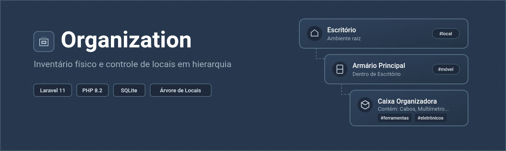
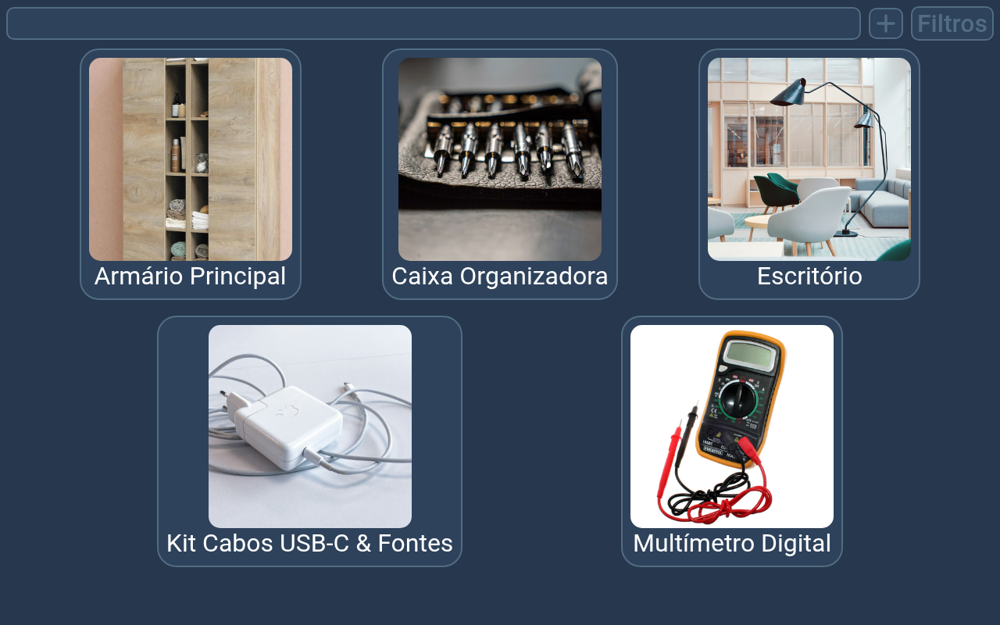
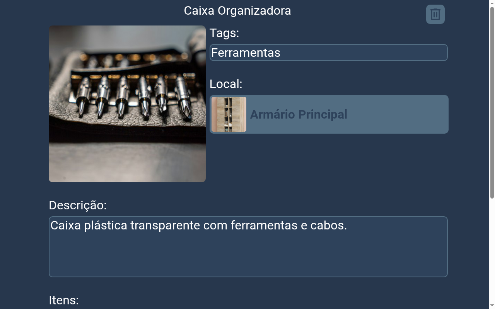
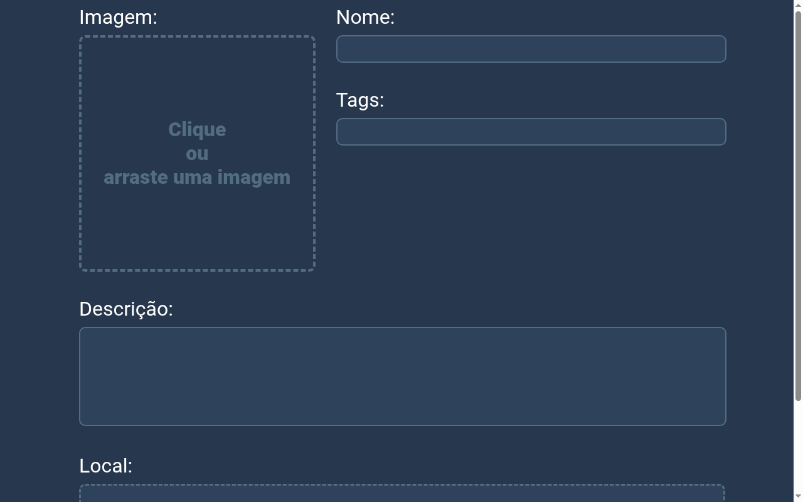

<p align="center">
  
</p>

# Organization

Sistema simples em Laravel para cadastrar e organizar objetos e seus locais físicos de armazenamento.

A ideia principal do projeto é resolver a dúvida de *"onde é que eu guardei tal coisa?"*. Em vez de ser só uma lista solta de itens, os objetos podem ser vinculados uns dentro dos outros de forma hierárquica (por exemplo: um cabo dentro de uma gaveta, que fica dentro de um armário, que fica no escritório).

---

## Telas do Sistema

### 1. Página Inicial (Busca e Filtros)
Lista os itens cadastrados com busca por texto em tempo real, filtro lateral por tags e rolagem infinita.



### 2. Detalhes do Item
Mostra a foto, a descrição, as tags, o local onde o item está guardado (com link direto para ele) e a lista de itens que estão guardados dentro dele.



### 3. Cadastro de Item
Permite cadastrar o nome, descrição, foto, adicionar tags e selecionar em qual item/local existente ele vai ficar guardado.



---

## Como o sistema funciona

- **Hierarquia de Locais**: Qualquer item pode ser tanto um "objeto" quanto um "local". Quando você define o campo `Local` de um item, ele passa a pertencer àquele compartimento. Se você abrir o compartimento, verá todos os itens que estão lá dentro.
- **Tags dinâmicas**: Você pode adicionar qualquer tag na hora de cadastrar (usando a caixinha com auto-complete). Se uma tag deixar de ser usada por todos os itens, ela é removida automaticamente do banco.
- **Associação rápida**: Na página de visualização de um local, dá para vincular novos itens a ele diretamente clicando em "Adicionar item".
- **Upload de fotos**: Cada item tem uma imagem associada para facilitar a identificação visual.

---

## Tecnologias utilizadas

- **PHP 8.2+** com **Laravel 11**
- **SQLite** como banco de dados padrão
- **JavaScript Vanilla** e **CSS** próprio (sem frameworks pesados no front)
- **Tagify** para o input de tags
- **Vite** para o bundle de assets

---

## Como rodar o projeto localmente

### Pré-requisitos
- PHP 8.2 ou superior (com extensões `pdo_sqlite`, `sqlite3`, `dom`, `gd` e `xml` ativas)
- Composer
- Node.js e npm

### Passo a passo

1. **Clonar o repositório:**
   ```bash
   git clone https://github.com/obertobr/organization.git
   cd organization
   ```

2. **Instalar as dependências do PHP:**
   ```bash
   composer install
   ```

3. **Instalar as dependências do front e gerar o build:**
   ```bash
   npm install
   npm run build
   ```

4. **Configurar o arquivo de ambiente:**
   ```bash
   cp .env.example .env
   php artisan key:generate
   ```

5. **Criar o banco SQLite e rodar as migrações:**
   ```bash
   touch database/database.sqlite
   php artisan migrate
   ```

6. **Criar o link para as imagens públicas:**
   ```bash
   php artisan storage:link
   ```

7. **Iniciar o servidor de desenvolvimento:**
   ```bash
   php artisan serve
   ```

O sistema estará acessível em `http://localhost:8000`.

---

## Como a IA foi utilizada neste projeto?

O código da aplicação (arquitetura Laravel, regras de negócio no backend, modelagem do banco de dados e interface em JavaScript e CSS) foi desenvolvido manualmente pelo autor. A inteligência artificial foi utilizada pontualmente e exclusivamente para a elaboração deste README: auxiliando na organização do texto descritivo, formatação do guia de instalação e criação do banner vetorial.

